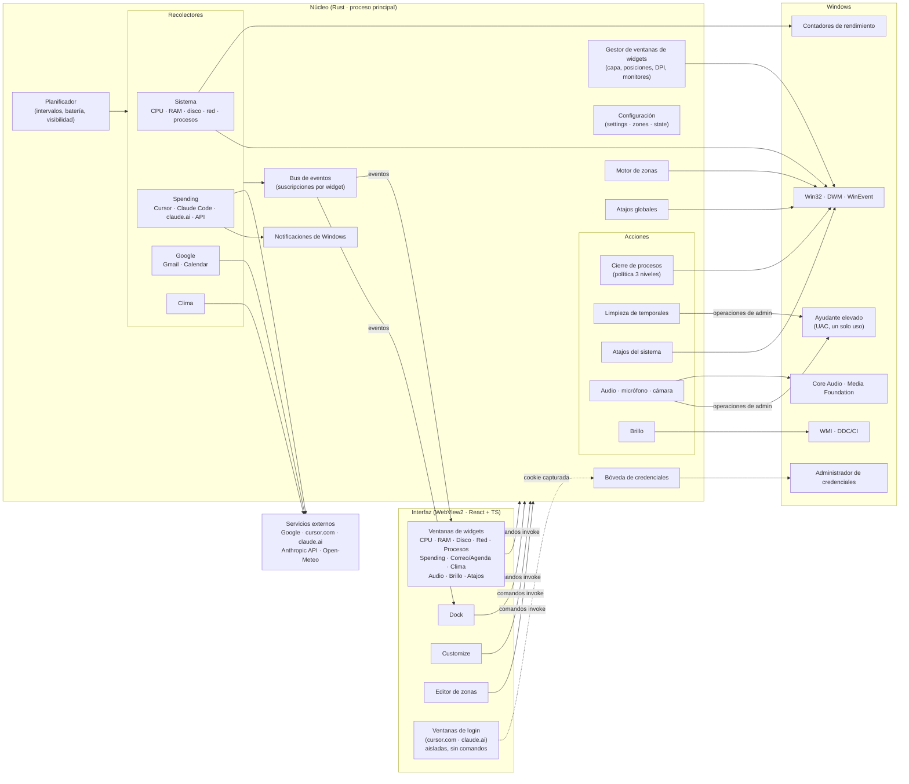
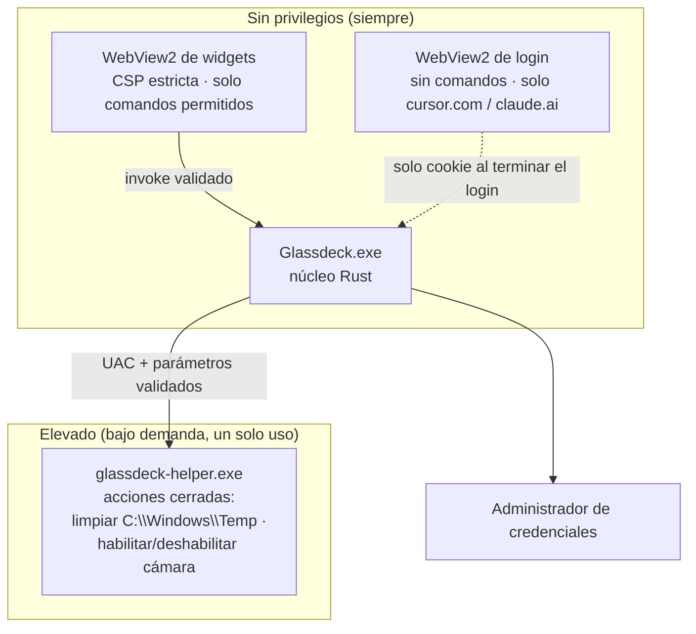
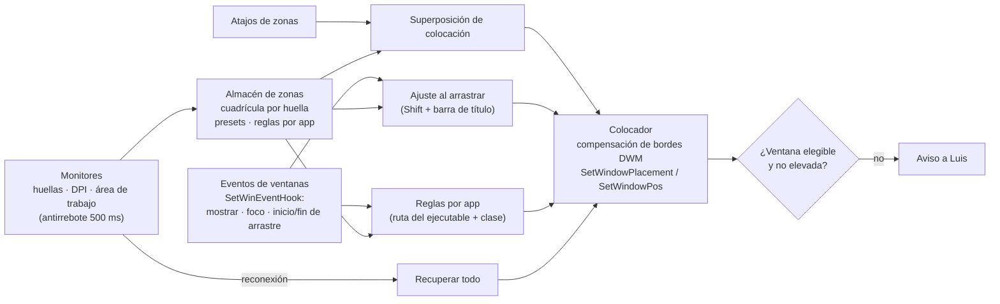

# Glassdeck — Arquitectura

Complementa a `SPEC.md`. Los identificadores `GD-*` remiten a sus requerimientos.

## 1. Vista general

Glassdeck es una sola app Tauri 2: un proceso principal en Rust, dueño de todos los datos y operaciones del sistema, y varias ventanas WebView2 (una por widget, más el dock, Customize y el editor de zonas) con la interfaz en React + TypeScript. La interfaz solo dibuja; nunca toca red ni disco directamente (GD-NFR-SEC-03).



## 2. Componentes del núcleo (Rust)

| Componente | Responsabilidad | Requerimientos | Base técnica prevista |
|---|---|---|---|
| Gestor de ventanas de widgets | Crear y destruir ventanas, *acrylic* y desenfoque al arrastrar, capa de escritorio o siempre encima, posiciones por monitor, regreso al principal al desconectar | GD-WIN-*, GD-NFR-PERF-04 | `tauri` (ventanas sin marco, transparentes, `skipTaskbar`), `window-vibrancy` (`apply_acrylic` / `apply_blur`), `windows` crate (`SetWindowPos`, `WM_DISPLAYCHANGE`, `EnumDisplayMonitors`, `GetDpiForMonitor`) |
| Planificador | Un temporizador por fuente con su intervalo; pausa si nadie está suscrito, si el widget está oculto o hay app a pantalla completa; modo batería | GD-NFR-PERF-03/04/05 | `tokio` (intervalos), `GetSystemPowerStatus`, `SHQueryUserNotificationState` |
| Bus de eventos | Publica cada lectura solo a las ventanas suscritas; agrupa envíos a 1 por segundo | GD-NFR-PERF-01 | Eventos de Tauri por ventana |
| Configuración | Leer y validar `settings.json`, `zones.json`, `state.json`; migraciones por versión; escritura atómica con respaldo | GD-CUST-*, GD-NFR-REL-03 | `serde`, `serde_json` |
| Bóveda de credenciales | Guardar y leer secretos con prefijo `Glassdeck/`; nunca exponerlos a la interfaz | GD-NFR-SEC-01 | `keyring` (Administrador de credenciales) |
| Recolector de sistema | CPU total y por núcleo, RAM con desglose, disco (espacio y E/S), red por adaptador, lista de procesos con dueño | GD-SYS-*, GD-PROC-01/02 | `sysinfo` + contadores de rendimiento (PDH) para E/S de disco y caché de RAM; `GetTokenInformation` para el dueño del proceso |
| Recolector de spending | Adaptador Cursor (no oficial), lector de JSONL de Claude Code con tabla de precios, adaptador claude.ai (no oficial), cliente de la API de costos de Anthropic | GD-CUR-*, GD-CLA-* | `reqwest` (cookies de la bóveda), `serde_json` en modo flujo; lectura incremental de JSONL por posición de archivo |
| Recolector de Google | OAuth de escritorio con PKCE y redirección a `127.0.0.1`, varias cuentas, Gmail `messages.list` + `messages.get` con `format=metadata`, Calendar `events.list` | GD-MAIL-*, GD-CAL-01 | `oauth2`, `reqwest` |
| Recolector de clima | Open-Meteo actual, por hora y diario; geolocalización por IP o ciudad fija | GD-WX-* | `reqwest` |
| Rotador de alertas | Mezcla correos no leídos y eventos, prioridad a eventos en < 30 min, rotación configurable | GD-ROT-01 | En memoria |
| Política de procesos | Clasifica cada proceso en lista negra, reforzado o normal; el backend vuelve a validar al ejecutar | GD-PROC-03/04/05/08 | Lista fija compilada + lista del usuario |
| Cierre de procesos | `WM_CLOSE` a las ventanas del proceso, espera de 5 s y luego `TerminateProcess`; resultado por proceso | GD-PROC-06/07 | `EnumWindows`, `PostMessage`, `OpenProcess`, `TerminateProcess` |
| Limpieza | Vista previa (tamaños), borrado de archivos con > 24 h, omitir en uso, no seguir uniones | GD-CLEAN-* | `walkdir` sin seguir enlaces; ayudante elevado para `C:\Windows\Temp` |
| Atajos del sistema | Plan de energía, reiniciar Explorer, limpiar DNS, vaciar papelera, bloquear, suspender, Administrador de tareas | GD-SHORT-* | `PowerSetActiveScheme`, `DnsFlushResolverCache`, `SHEmptyRecycleBin`, `LockWorkStation`, `SetSuspendState` |
| Audio | Volumen y silencio general, dispositivo predeterminado, sesiones por app, salida por app, micrófono y medidor | GD-AUD-*, GD-MIC-01 | Core Audio (`IMMDeviceEnumerator`, `IAudioEndpointVolume`, `IAudioSessionManager2`, `IAudioMeterInformation`); `IPolicyConfig` para predeterminado y `IAudioPolicyConfigFactory` (no documentada) para salida por app |
| Cámara | Lista de cámaras, ajustes soportados, deshabilitar dispositivo | GD-CAM-* | Vista previa con `getUserMedia` en la ventana del widget; ajustes con `IAMVideoProcAmp` / `IAMCameraControl`; deshabilitar con SetupAPI vía ayudante elevado |
| Brillo | Pantalla interna y monitores externos | GD-BRI-* | WMI `WmiMonitorBrightnessMethods`; DDC/CI con `GetPhysicalMonitorsFromHMONITOR` + `SetVCPFeature(0x10)` (Dxva2) |
| Atajos globales | Registro y detección de conflictos | GD-HOT-*, GD-CUST-06 | `tauri-plugin-global-shortcut` (`RegisterHotKey`) |
| Notificaciones | Avisos de umbral con acción de abrir | GD-ALERT-* | `tauri-plugin-notification` |
| Motor de zonas | Huellas de monitor, cuadrículas, superposición, modificadores, memoria por app, recuperar todo | GD-ZONE-* | Ver sección 5 |
| Ciclo de vida | Instancia única, arranque con Windows, bandeja | GD-DOCK-04/05, GD-INST-* | `tauri-plugin-single-instance`, `tauri-plugin-autostart`, bandeja de Tauri |

## 3. Interfaz (React + TypeScript)

- **Una base de código y varios puntos de entrada:** cada ventana carga la misma app con un parámetro `?vista=cpu|ram|…|dock|customize|zonas`. Así se comparten componentes, tema y estado.
- **Sistema de diseño de vidrio:** variables CSS para el tema (oscuro y claro), el acento y el desenfoque; componentes de medidor circular, sparkline, barra, lista, píldora y diálogo de confirmación. El *acrylic* lo pone Windows; la interfaz dibuja el brillo superior, el borde de luz y el reflejo que sigue al mouse.
- **Gráficas:** SVG o canvas propios y ligeros, sin librerías pesadas, para cuidar la RAM.
- **Estado:** cada widget se suscribe solo a su fuente; el historial de 1 h lo guarda el núcleo en un búfer circular y la interfaz lo pide al maximizar.
- **Accesibilidad:** `aria-label` en botones de icono, foco visible, `prefers-reduced-motion`.

## 4. Seguridad



- **Capacidades de Tauri por ventana:** los widgets solo pueden invocar los comandos de su módulo; Customize y el dock tienen los de configuración; las ventanas de login no tienen ninguno.
- **Ayudante elevado:** ejecutable aparte con un conjunto cerrado de acciones. No acepta rutas ni comandos arbitrarios: recibe un código de acción y el núcleo valida todo antes de pedir UAC.
- **Captura de cookies:** al detectar el fin del login (navegación al dashboard), el núcleo lee la cookie del almacén de WebView2 de esa ventana, la guarda en la bóveda y destruye la ventana y su perfil.
- **Logs:** pasan por un filtro que enmascara secretos, asuntos, títulos y rutas de usuario.

## 5. Motor de zonas (fase 4)

Diseño propio inspirado en el comportamiento de MaxTo (ver `referencias/MAXTO_ANALISIS.md`).



- **Superposición:** una ventana WebView2 transparente por monitor, creada al abrir la superposición y destruida al cerrarla para no consumir RAM en reposo. Los modificadores se leen con eventos de teclado de esa ventana, que tiene el foco mientras está abierta.
- **Ajuste al arrastrar:** `EVENT_SYSTEM_MOVESIZESTART` y `EVENT_SYSTEM_MOVESIZEEND`. Durante el arrastre, un temporizador de 16 ms lee la posición del cursor y el estado de `Shift` para iluminar la zona. No se usan ganchos de bajo nivel (GD-ZONE-14).
- **Compensación de bordes:** se calcula la diferencia entre `GetWindowRect` y los límites extendidos del marco de DWM y se ajusta el rectángulo destino.
- **Exclusiones:** ventanas de Glassdeck, del shell, herramientas (`WS_EX_TOOLWINDOW`), invisibles, minimizadas, sin título, a pantalla completa y de procesos elevados.

## 6. Estructura del repositorio prevista

```text
tools/glassdeck/
├── docs/                      # este paquete de especificación
├── src/                       # interfaz React + TypeScript
│   ├── vistas/                # cpu, ram, disco, red, procesos, spending, correo, clima, audio, brillo, atajos, dock, customize, zonas
│   ├── componentes/           # medidor, sparkline, pildora, dialogo, vidrio…
│   └── tema/
├── src-tauri/
│   ├── src/
│   │   ├── ventanas/          # gestor de ventanas de widgets
│   │   ├── recolectores/      # sistema, spending, google, clima
│   │   ├── acciones/          # procesos, limpieza, atajos, audio, camara, brillo
│   │   ├── zonas/
│   │   ├── config/
│   │   └── seguridad/         # bóveda, filtro de logs
│   ├── capabilities/          # permisos por ventana
│   └── tauri.conf.json
└── helper/                    # glassdeck-helper.exe (acciones elevadas)
```

## 7. Entorno de desarrollo (fase 0)

Estado revisado el 2026-10-27, antes de instalar (83 GB libres en `C:`).

| Requisito | Estado en el equipo de Luis | Acción |
|---|---|---|
| Node 24 + npm | Instalado (v24.14.1) | — |
| Rust (stable, `x86_64-pc-windows-msvc`) | No instalado | `winget install Rustlang.Rustup` (por usuario, sin UAC) |
| Visual Studio Build Tools 2022 con el workload `VCTools` | No instalado (~6 GB) | `winget install Microsoft.VisualStudio.2022.BuildTools` con `--add Microsoft.VisualStudio.Workload.VCTools` (pide UAC) |
| WebView2 Runtime | Incluido en Windows 10 actualizado | Verificar versión en el registro |
| Control de versiones | — | Git local en `tools/glassdeck`, rama `main`, sin remoto |

Los resultados de la prueba de RAM y la estrategia de ventanas elegida quedan en `adr/ADR-001-estrategia-ventanas.md`.
