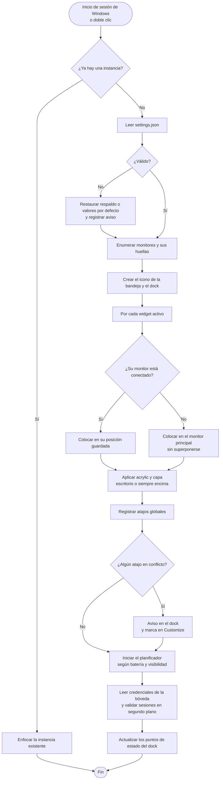
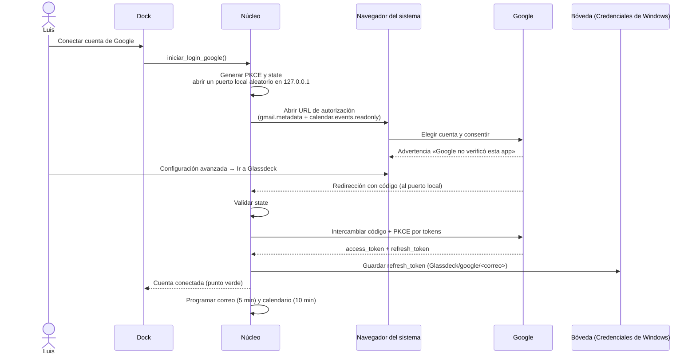
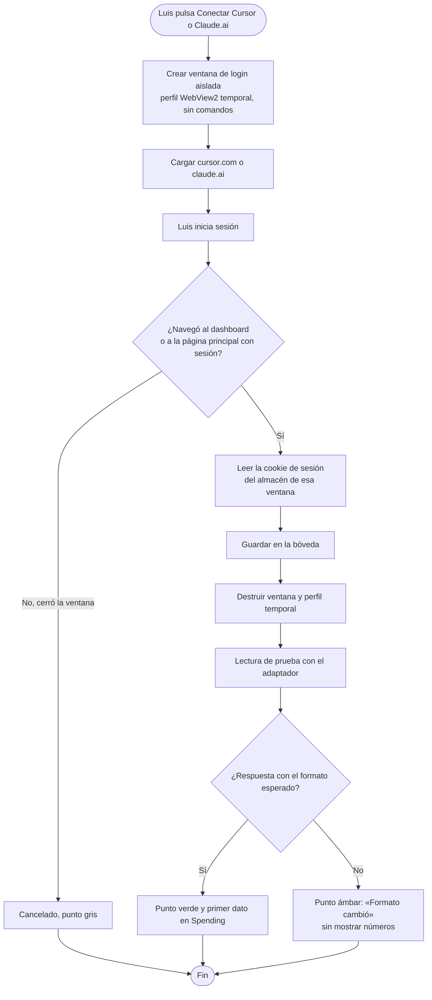
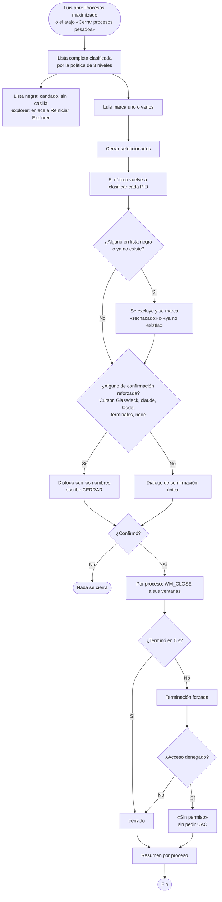
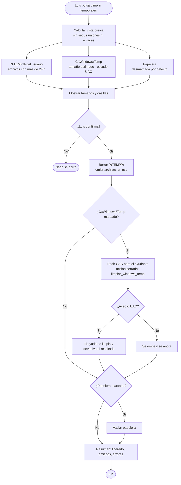
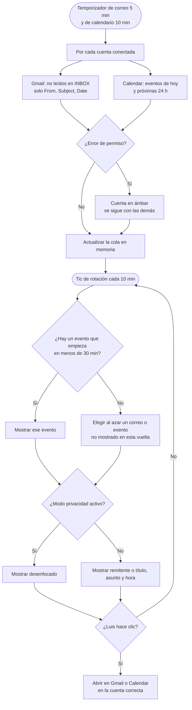
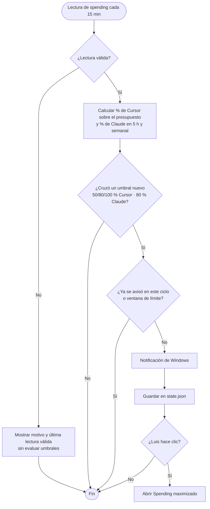
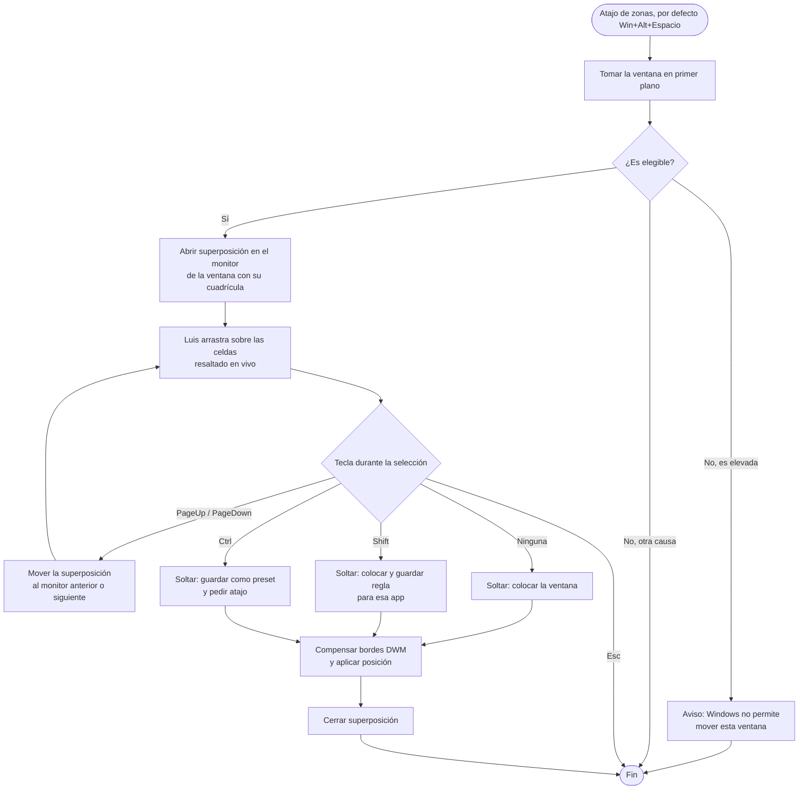
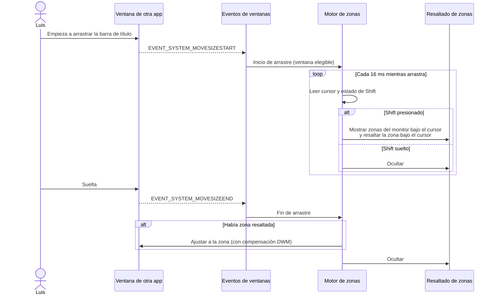
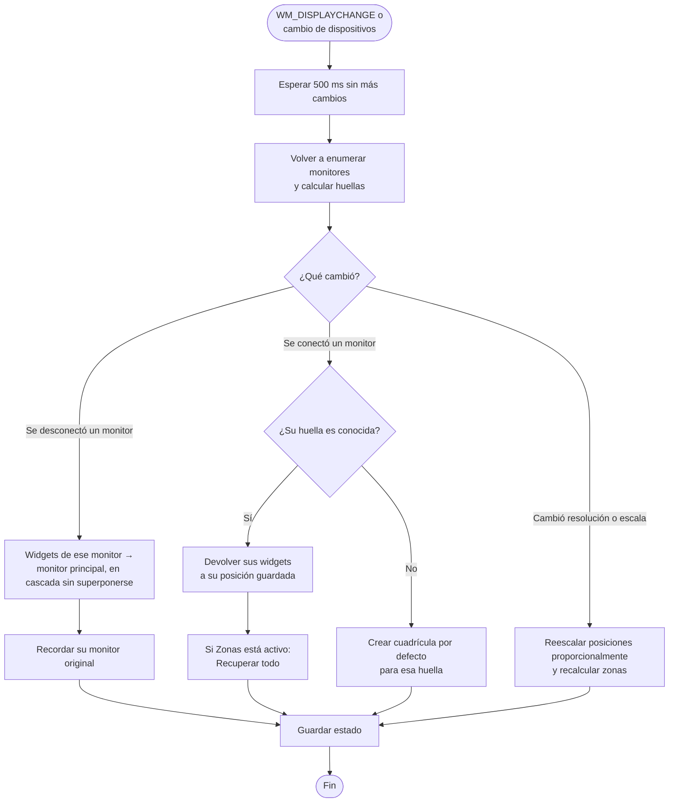

# Glassdeck — Diagramas de flujo

Complementa a `SPEC.md` y `ARQUITECTURA.md`.

## 1. Arranque

## 2. Login de Google (una o varias cuentas)

## 3. Login de Cursor y de claude.ai (no oficial)

Claude Code no requiere login: el recolector lee los registros locales al arrancar y cada 15 min de forma incremental.

## 4. Cerrar procesos

## 5. Limpiar temporales

## 6. Rotación de la alerta de correo y agenda

## 7. Aviso de umbral de gasto

## 8. Colocar una ventana en una zona

### 8.1 Con la superposición (atajo)

### 8.2 Al arrastrar con Shift

## 9. Cambio de monitores

